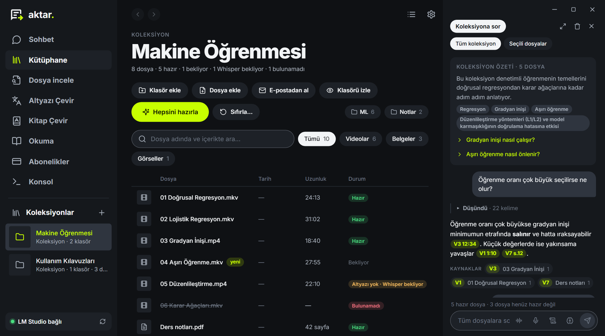

<div align="center">
  <picture>
    <source media="(prefers-color-scheme: dark)" srcset="assets/logo-dark.svg">
    
  </picture>
  <p><a href="https://github.com/Tintler/aktar/actions/workflows/tests.yml"></a></p>
</div>



Videolarınızı, belgelerinizi ve kitaplarınızı **yerel bir yapay zeka modeliyle** işleyen masaüstü uygulaması: altyazıları ve e-kitapları Türkçeye (ya da seçtiğiniz başka bir dile) çevirir, koleksiyonlarınıza soru sormanızı sağlar ve cevapları zaman damgalı kaynaklarla gösterir. Kitapları sesli okur, videolara Türkçe dublaj ekler.

> **Gizlilik:** Bilgisayarınızdaki ya da yerel ağınızdaki bir model sunucusuyla (LM Studio, Ollama, llama.cpp…) hiçbir veri internete gönderilmez; kaynak dosyalar yalnızca okunur, değiştirilmez. İsterseniz internetteki OpenAI uyumlu bir sunucu da seçebilirsiniz; o zaman metinler o sunucuya gider ve Ayarlar bunu açıkça uyarır.

> **English:** Aktar is a local-first desktop app (Windows, Linux) that translates video subtitles and e-books (EPUB, MOBI, AZW3, FB2, PDF) between 18 languages (Turkish by default), lets you chat with your videos and documents, reads books aloud and dubs videos, using an LLM served by LM Studio or any OpenAI-compatible server (Ollama, llama.cpp, vLLM…) and local speech engines. With a local server nothing leaves your machine.

---

## Özellikler

**Kütüphane ve sohbet**

- **Kütüphane:** Klasörleri, videoları, belgeleri (PDF, Word, Excel, EPUB…) ve görselleri koleksiyonlarda toplar; tek tıkla hepsini aranabilir hale getirir.
- **Koleksiyona sor:** Tüm koleksiyona birden soru sorun; cevaptaki `V3 12:34` gibi atıflara tıklayınca video o anda açılır.
- **Sohbet ve Dosya incele:** Serbest sohbet ya da tek bir dosyayı koleksiyona eklemeden açıp soru sorma.
- **Sesli mod:** Sohbetlerde konuşarak soru sorun; cevap üretilirken cümle cümle sesli okunur. Konuşma Whisper ile bilgisayarınızda metne çevrilir.
- **Videonun görüntüsü:** İsteğe bağlı olarak görüntü değiştikçe kare alınır; slayt yazıları OCR ile, sahneler görü modeliyle okunur ve sorulara katılır.
- **Klasör izleme, e-posta ve ekstreler:** Uygulama açıkken izlenen klasörlere ve Gmail'e düşen dosyalar kendiliğinden hazırlanır; banka ve kart ekstrelerinden abonelik, fatura ve harcama takibi yapılır.

**Video ve altyazı**

- **Altyazı çevirisi:** SRT, ASS, SSA ve VTT biçimleri, zamanlamalar ve ASS etiketleri korunur. Dizi bölümleri arasında terim sözlüğü ve isim tutarlılığı sağlanır.
- **Çeviri dilleri:** Kaynak dil (ya da Otomatik) ve hedef dil 18 dil arasından seçilir; varsayılan İngilizce → Türkçe. Çıktı dosyası hedef dilin kodunu ek alır (`_TR`, `_DE`, `_JA`…).
- **Altyazısız videolar:** faster-whisper ile konuşma yerelde metne çevrilir (isteğe bağlı, NVIDIA GPU desteğiyle).
- **Altyazı araçları:** Kaymış altyazı G/H ile, iki noktadan ya da Whisper'a göre otomatik hizalanır (kare hızı farkı dahil). Karaoke ASS (`\k`), kelime vurgulu SRT ve JSON çıktısı alınır. PGS/VobSub görüntü altyazıları OCR ile metne çevrilir.
- **Türkçe dublaj:** Seçili altyazı ses motoruyla seslendirilir ve videoya varsayılan ses parçası olarak eklenir. İsteğe bağlı olarak müzik ve efektler ayrılıp korunur (yalnızca özgün konuşma kısılır) ve her konuşmacı ayrı bir sesle okunur.
- **Konuşmacı ayrımı:** Videoda kimin ne zaman konuştuğu bulunur; transkript ve soru-cevap `K1:`, `K2:` (ya da verdiğiniz adlarla) etiketlenir.
- **Klip:** Seçilen aralık MP4/MKV/GIF ya da ses olarak kaydedilir; altyazı ayrı dosya, gömülü ya da görüntüye yakılmış (karaoke dahil) eklenebilir.
- **Yerleşik oynatıcı:** MKV, AC3/DTS gibi biçimler FFmpeg (ya da libmpv) ile oynatılır.

**Kitap**

- **Kitap Çevir:** DRM'siz e-kitapları (EPUB, MOBI, AZW3, FB2) bölüm bölüm seçilen dile çevirir; terim sözlüğü, kalite denetimleri, kaldığı yerden sürme ve EPUB çıktısı. MOBI/AZW3 için Calibre kuruluysa o kullanılır, yoksa yerleşik okuyucu.
- **Okuma:** E-kitap kitaplığı (EPUB, MOBI, AZW3, FB2); içindekiler, yer imleri, yazı ve sayfa ayarları, okuma konumu.
- **Kitapta ara:** Ctrl+F ile kelime ya da cümle tüm kitapta aranır; sonuca tıklayınca bölüm açılıp eşleşme vurgulanır.
- **Kitaba sor:** Okurken kitaba soru sorun ("3. bölümde ne oldu?"); cevaptaki bölüm atfı kitabı o bölüme götürür. **Okuduğum yere kadar** seçiliyse okuduğunuz yerden (bölüm içindeki konum dahil) sonrası modele hiç gitmez.
- **Sesli okuma ve sesli kitap:** Kitaplar yerel ses motorlarıyla (EMA Lightning, VoxCPM) cümle cümle okunur; tarifle tasarlanan ya da kayıttan klonlanan sesler kullanılabilir. **Drama 3 (Türkçe)** motoru, kendi başlattığınız bir SGLang-Omni sunucusuna bağlanıp Fish Audio Drama 3 ile klon sesle okur (Built with Fish Audio; rızası olmadan tanınabilir kişilerin sesini klonlamak yasaktır). Kitabın tamamı bölüm işaretli M4B ya da bölüm başına MP3 olarak kaydedilir.
- **Telefon sesi:** Telefondaki Sesli Haber uygulaması haberleri aynı Wi-Fi'deyken Aktar'ın sesiyle okur; Aktar kapalıysa telefonun kendi sesine geçer (Ayarlar › Bağlantılar).
- **PDF'den kitap:** Metin katmanı olan PDF'ler doğrudan, taranmış PDF'ler OCR ile (kitabın diliyle) okunur, üst/alt bilgilerden ve bölünmüş kelimelerden temizlenir, bölümlere ayrılır ve EPUB'a dönüştürülür; sonuç **Gözden geçir** ekranında sayfa görüntüsünün yanında düzeltilir.

**Genel**

- **Arka plan işleri:** Çeviri, hazırlık, OCR ve ses işleri sağ üstteki listede ilerlemesiyle görünür (yalnızca uygulama açıkken çalışır).
- **Temalar:** Koyu, açık ve hazır renk temaları; kendi temanızı da ekleyebilirsiniz.

---

## Gereksinimler

- Windows 10/11 veya Linux
- Python 3.10+ ve Node.js (kaynak koddan çalıştırmak için)
- FFmpeg (`bin\` klasörüne, bkz. [bin/README.txt](bin/README.txt))
- Bir model sunucusu: [LM Studio](https://lmstudio.ai) ya da OpenAI uyumlu başka bir sunucu (Ollama, llama.cpp, vLLM; internette OpenAI, OpenRouter). İlk açılıştaki **Bileşen denetimi** eksik olanları ve nasıl kurulacaklarını gösterir.
- İsteğe bağlı: [Calibre](https://calibre-ebook.com) (MOBI/AZW3 için en iyi sonuç)
- İsteğe bağlı: Whisper ile ses ayırma ve konuşmacı ayrımı (`requirements-whisper.txt`), sesli okuma motorları (`requirements-tts.txt`), Tesseract OCR

---

## Hızlı başlangıç

**Windows:**

```bat
py -3 -m pip install -r requirements.txt
GUI_BASLAT.cmd
```

**Linux:**

```bash
./kur.sh --kisayol
./baslat.sh
```

Açılan **Kütüphane** sayfasına bir klasör sürükleyin; koleksiyon oluşur. Ayarlar, derleme, Linux paketleri ve komut satırı kullanımı için bkz. **[KULLANIM.md](KULLANIM.md)**.

---

## Proje yapısı

| Klasör / dosya | İçerik |
|---|---|
| `desktop.py` | Giriş noktası: arayüzü pywebview penceresinde açar |
| `src/` | Python arka ucu (çeviri, kütüphane, soru-cevap, kitap, ses, `bridge_*.py` köprüleri) |
| `web/` | Svelte arayüzü |
| `engines/` | Sesli okuma motorları (EMA Lightning, VoxCPM; Drama 3 yalnızca motor.json, istemcisi `src/drama3.py`) |
| `tests/` | Birim testleri: `py -3 -m unittest discover -s tests` |
| `tools/` | Geliştirme araçları (`dev_rpc.py`, `build_engines.py`) |
| `assets/` | Logo, simgeler ve hazır temalar |
| `bin/` | FFmpeg, ffprobe ve libmpv ikilileri (repoda yok) |
| `DERLE*.cmd`, `derle*.sh` | `.exe`, Whisper paketi ve ses motoru derlemeleri |

---

## Sınırlamalar

- Görüntü tabanlı altyazılar (PGS/VobSub) önce OCR ile okunur; okuma kalitesi seçilen OCR motoruna bağlıdır.
- Cevaplar transkripte dayanır; videodaki görüntü yalnızca **Videoların görüntüsünü de oku** seçilerek hazırlanan videolarda, alınan karelerden görülür.
- Uygulama kapalıyken arka planda hiçbir şey çalışmaz; klasör izleme ve e-posta kontrolü yalnızca uygulama açıkken yapılır.
- Çeviri kalitesi seçilen modele bağlıdır.

---

## Sürümler

Güncel sürüm `src/version.py` içindedir ve **Ayarlar → Gelişmiş**'te görünür; değişiklikler [CHANGELOG.md](CHANGELOG.md) dosyasındadır.

---

## Lisans

MIT — bkz. [LICENSE](LICENSE).
