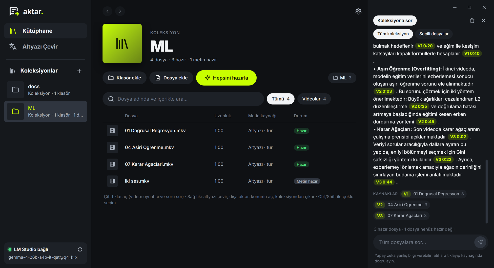

<div align="center">
  <picture>
    <source media="(prefers-color-scheme: dark)" srcset="assets/logo-dark.svg">
    
  </picture>
</div>



Videolarınızı ve belgelerinizi **yerel bir yapay zeka modeliyle** inceleyen masaüstü uygulaması: altyazıları Türkçeye çevirir, koleksiyonlarınıza soru sorabilir, cevapları zaman damgalı kaynaklarla gösterir.

> **Gizlilik:** Hiçbir veri internete gönderilmez. Tüm işlemler LM Studio sunucunuzda yapılır; kaynak dosyalar yalnızca okunur, değiştirilmez.

> **English:** Aktar is a local-first desktop app (Windows, Linux) that translates video subtitles to Turkish and lets you chat with your videos and documents, using an LLM served by LM Studio. Nothing leaves your machine.

---

## Özellikler

- **Kütüphane:** Klasörleri, videoları, belgeleri (PDF, Word, Excel, EPUB…) ve görselleri koleksiyonlarda toplar; tek tıkla hepsini aranabilir hale getirir.
- **Koleksiyona sor:** Tüm koleksiyona birden soru sorun; cevaptaki `V3 12:34` gibi atıflara tıklayınca video o anda açılır.
- **Sohbet ve Dosya incele:** Serbest sohbet ya da tek bir dosyayı koleksiyona eklemeden açıp soru sorma.
- **Altyazı çevirisi:** SRT, ASS, SSA ve VTT biçimleri, zamanlamalar ve ASS etiketleri korunur. Dizi bölümleri arasında terim sözlüğü ve isim tutarlılığı sağlanır.
- **Altyazısız videolar:** faster-whisper ile konuşma yerelde metne çevrilir (isteğe bağlı, NVIDIA GPU desteğiyle).
- **Yerleşik oynatıcı:** MKV, AC3/DTS gibi biçimler FFmpeg ile dönüştürülerek oynatılır.
- **Temalar:** Koyu, açık ve hazır renk temaları; kendi temanızı da ekleyebilirsiniz.

---

## Gereksinimler

- Windows 10/11 veya Linux
- Python 3.10+ ve Node.js (kaynak koddan çalıştırmak için)
- FFmpeg (`bin\` klasörüne, bkz. [bin/README.txt](bin/README.txt))
- Yerel sunucusu açık ve bir model yüklü [LM Studio](https://lmstudio.ai)

---

## Hızlı başlangıç

**Windows:**

```bat
py -3 -m pip install -r requirements.txt
GUI_BASLAT.cmd
```

**Linux:**

```bash
./kur.sh --kisayol
./baslat.sh
```

Açılan **Kütüphane** sayfasına bir klasör sürükleyin; koleksiyon oluşur. Ayarlar, derleme, Linux paketleri ve komut satırı kullanımı için bkz. **[KULLANIM.md](KULLANIM.md)**.

---

## Sınırlamalar

- Yalnızca metin tabanlı altyazılar çevrilir; PGS/VobSub gibi görüntü tabanlı altyazılar desteklenmez.
- Cevaplar transkripte dayanır; videodaki görüntü içeriği görülmez.
- Çeviri kalitesi seçilen modele bağlıdır.

---

## Lisans

MIT — bkz. [LICENSE](LICENSE).
